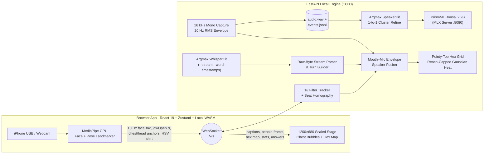

<div align="center">


# Roundtable

**Your conversation, mapped — live, offline, for everyone.**

*Built at the **Cornell Local AI Hackathon** · Accessibility Track*

<p align="center">
  <a href="https://github.com/argmaxinc/WhisperKit"></a>
  <a href="https://github.com/argmaxinc/WhisperKit"></a>
  <a href="https://huggingface.co/prism-ml"></a>
  <a href="https://github.com/ml-explore/mlx"></a>
</p>

<p align="center">
  <a href="https://ai.google.dev/edge/mediapipe/solutions/vision/face_landmarker"></a>
  <a href="https://react.dev"></a>
  <a href="https://zustand-demo.pmnd.rs"></a>
  <a href="https://fastapi.tiangolo.com"></a>
  <a href="https://vite.dev"></a>
  
  
</p>

<p align="center">
  <a href="#the-accessibility-story">Accessibility Story</a> ·
  <a href="#what-roundtable-does">Features</a> ·
  <a href="#models--tools">Models &amp; Tools</a> ·
  <a href="#architecture">Architecture</a> ·
  <a href="#challenges-we-ran-into">Challenges</a> ·
  <a href="#quickstart">Quickstart</a>
</p>

</div>

---

## The Accessibility Story

Imagine sitting in a university seminar or a three-person project sync as a Deaf or hard-of-hearing student. Standard live-captioning apps stream a single, unattributed ribbon of text at the bottom of your laptop. By the time you look up, scan three faces to figure out whose mouth is moving, and look back down, the conversation has already moved on—and if someone calls your name to ask what you think, you often miss the cue completely.

**Roundtable** turns one Apple Silicon laptop, a camera, and a table mic into an **offline, spatial conversation mapper**:

- **Who is talking** is unmistakable: captions appear as color- and shape-coded speech bubbles **pinned directly to each speaker's chest**.
- **Where speech happens** is spatial: a live **top-down hex room map** glows around active seats and follows participants if they stand or move.
- **When your name is called**, you never miss it: the entire stage pulses, the speaker's bubble highlights, and the turn is bookmarked in history.
- **Nothing leaves the room**: Argmax hears, Bonsai thinks, MediaPipe watches, and zero bytes touch the internet.

**The curb-cut effect:** just as sidewalk ramps and closed captions serve everyone, spatial live attribution, unanswered-question tracking, talk-time balance, and cited post-meeting Q&A turn every seminar, roundtable, or study group into an effortlessly searchable record.

---

## What Roundtable Does

<table>
<tr>
<td width="33%" valign="top">

### 1 · Setup &amp; 3s Enrollment
- **Tabletop Homography:** Optional 4-corner perspective calibration maps camera pixels onto physical meters (`1.8 m × 0.9 m`), with automatic horizontal seating fallback for laptop webcams.
- **Gated 3-Second Voice Samples:** Each speaker clicks **Begin recording** and reads two short lines (~3 s) starting with their name.
- **Instant SpeakerKit Verification:** Verifies right on the enrollment screen that all voices separate into distinct clusters—warning immediately if two voices sound alike.
- **Live Self-Intro Lock:** Saying *"Hi, I'm Yoav"* or *"My name is Cello"* in live mode automatically binds both your face and voice on the fly.

</td>
<td width="34%" valign="top">

### 2 · Live View (`1200 × 680`)
- **Chest-Pinned Speech Bubbles:** Collision-aware placement ladder (`chest → above name tag → side of face → top edge`) that **never covers a face**.
- **Color + Shape Redundancy:** Violet `●`, Teal `■`, Amber `◆`, Pink `▲`—colorblind-safe across bubbles, map markers, and transcripts.
- **Name-Call Stage Alert:** Case-insensitive, word-boundary name &amp; alias detection flashes the stage border and highlights the turn.
- **Pointy-Top Axial Hex Map:** Real-time Gaussian acoustic heat (`σ = 0.35 m`) with `√talk_share` reach caps for spatial fairness.
- **Live Lanes, Talk Rings &amp; `⌘K` Ask:** Real-time *"Who spoke when"* timeline, unanswered/overdue question counter, large captions (`L`), history drawer (`H`), and inline cited Q&amp;A (`⌘K`).

</td>
<td width="33%" valign="top">

### 3 · Stop, Refine &amp; Review
- **Full-WAV SpeakerKit Diarization:** Re-labels the entire session by voice (*"Corrected N of M turns"*), matching clusters 1-to-1 and splitting mid-turn handoffs at word boundaries.
- **Bonsai 2 2B Synthesis:** Runs locally after `Stop` (staying idle during live speech to protect the 8 GB RAM ceiling) to tag questions, decisions, and action items.
- **Cited Meeting Q&amp;A:** Answers typed questions using only recorded turns and highlights the exact cited turn IDs (`turn_0004`, `turn_0011`) in the transcript.
- **One-Key Demo Safety Net (`R`):** Instantly switches to a prerecorded, refined session clearly badged as a recording.

</td>
</tr>
</table>

---

## Models &amp; Tools

### On-Device AI Models

| Role | Model / Engine | Runtime | How Roundtable Uses It |
| --- | --- | --- | --- |
| **Streaming Speech-to-Text** | [**Argmax WhisperKit**](https://github.com/argmaxinc/WhisperKit) (`whisperkit-cli` / `argmax-cli`) | Apple Neural Engine + CoreML | Streams live mic captions (`--stream --word-timestamps`) conditioned on enrolled speaker names via `--prompt`. |
| **Speaker Diarization** | [**Argmax SpeakerKit**](https://github.com/argmaxinc/WhisperKit) (`diarize`) | Apple Neural Engine | Verifies distinct voices after 3 s enrollment, settles low-confidence live turns, and runs full-WAV diarization on `Stop` (~1.2 s for 2 min of audio). |
| **Local LLM Reasoning** | [**PrismML Bonsai 2 2B**](https://huggingface.co/prism-ml) | [**Apple MLX**](https://github.com/ml-explore/mlx) (`mlx_vlm.server` on `:8080`) | Schema-constrained JSON summaries, turn tagging (`question`, `decision`, `action`), and cited Q&amp;A with `<think>` mode disabled for low latency. |
| **Face &amp; Body Landmarks** | [**MediaPipe Face Landmarker**](https://ai.google.dev/edge/mediapipe/solutions/vision/face_landmarker) + [**Pose Landmarker Lite**](https://ai.google.dev/edge/mediapipe/solutions/vision/pose_landmarker) | Local WebAssembly + WebGL GPU | Alternates face (52 blendshapes incl. `jawOpen`) and pose inference in-browser at ~10 Hz with zero network fetches. |

### Application Stack

| Layer | Technologies |
| --- | --- |
| **Frontend** | [React 19](https://react.dev), [TypeScript 5.9](https://www.typescriptlang.org), [Zustand 5](https://github.com/pmndrs/zustand), [Vite 7](https://vite.dev), custom SVG spatial renderer, bundled `InterVariable` font, offline Service Worker |
| **Backend** | [Python 3.13](https://www.python.org), [FastAPI](https://fastapi.tiangolo.com), `asyncio` WebSockets, [`sounddevice`](https://python-sounddevice.readthedocs.io) (20 Hz PCM16 RMS capture), pure-Python homography / 1€ filter / axial hex engine |
| **Hardware &amp; Testing** | Apple Silicon MacBook Air (**M2, 8 GB unified memory**), iPhone Continuity Camera over USB (or built-in FaceTime HD camera), [Vitest](https://vitest.dev) + [Pytest](https://docs.pytest.org) (**116 automated tests**) |

---

## Architecture

Four strictly-local processes communicate over `127.0.0.1` via a versioned, mirrored schema (`backend/contract.py` ↔ `src/contract.ts`):



---

## Challenges We Ran Into

Building a multi-modal spatial captioner that actually holds up under real two- and three-person cross-talk on an **8 GB M2 MacBook Air** surfaced several subtle systems bugs we had to diagnose from live session recordings:

1. **Phase lag between camera mouth scores and microphone RMS:** MediaPipe's `jawOpen` activity score is a **0.60 s trailing standard deviation** (so a moving jaw scores high while a held-open jaw scores zero), whereas raw mic RMS arrives in **50 ms chunks** that dip toward zero on every consonant and syllable boundary. Naive point-by-point correlation frequently evaluated to zero mid-sentence and defaulted alphabetically to Speaker 1. Aligning fusion to a **0.65 s trailing RMS envelope** while subtracting each face's silent-room jaw baseline separated real talkers cleanly from nodding and silent chewing.
2. **PyAnnote right-edge instability during live diarization:** Benchmarking `whisperkit-cli diarize` on live recordings showed near-perfect cluster separation once speech was `≥4.2 s` behind the end of the file, but ~50/50 cluster flips inside the final unclosed 10-second sliding segmentation window. Letting mouth–mic fusion own the instantaneous `<1 s` live edge while running SpeakerKit only on settled `>4.2 s` windows stopped late cluster flips from hijacking active speech bubbles.
3. **Enrollment-to-live clock resets & webcam seat drift:** During single-person-at-a-time laptop enrollment, leaning in and out of frame caused face tracks to swap seats before `Start`, while pre-session enrollment timestamps (`t ≈ 200 s`) lingered in the heat-deposit and hysteresis timers after the session clock reset to `0.0`—freezing the hex map in live mode. Recording mouth-weighted screen `x` anchors across all tracks, resetting every filter/gate clock on `Start`, and adding spoken self-intro locking (*"I'm Yoav"*, including fuzzy phonetic matches for Whisper splits like *"I'm your av"*) locked names to the right seats.
4. **End-seat territory bias on the hex map:** On a rectangular table, speakers seated on the left and right ends have open margin space on three sides while the middle speaker is hemmed in—causing the *quietest* end speaker to own the most hexagons. Capping each speaker's radial reach at `max(0.35 m, 0.70 m × √(talk_i / talk_max))` around their peak energy restored visual fairness (`45 / 31 / 25%` test).
5. **Staying under 8 GB of unified memory:** Running macOS, Chrome WebGL vision, WhisperKit, SpeakerKit, and an LLM simultaneously leaves almost zero margin for swap. Keeping **Bonsai 2 2B** idle during live speech, disabling thinking tokens, warming SpeakerKit during enrollment, and capping MediaPipe to the enrolled headcount kept total RAM steady around **~6.0–6.5 GB**.

---

## Quickstart

### Prerequisites
- **Node.js 20+** and **Python 3.11+**
- **Live Hardware Mode (macOS Apple Silicon):** `brew install whisperkit-cli` + local `models/bonsai2-2b-mlx` weights.
- **Simulation / Replay Mode (macOS, Windows, Linux):** No microphone, camera, GPU, or model weights needed.

### Install
```bash
npm install
python3 -m pip install -r requirements.txt
```

### 1. Run the Full Live On-Device Stack (Apple Silicon Mac)
```bash
# One-time model setup while online:
npm run setup:models

# Builds UI, launches Bonsai 2 2B (:8080), and starts live FastAPI + Argmax (:8000):
npm run live
```
Open **`http://localhost:8000`** in **Google Chrome**. *(Stop with `Ctrl+C` or `pkill -TERM -f backend.app.server` so Argmax cleanly releases the mic.)*

### 2. Run Deterministic Simulation / Replay Mode (Any OS, Zero Hardware)
```bash
npm start
```
Open **`http://localhost:8000`** and press **Start replay** (or `R`) to run the 91-second, 3-speaker synthetic session (occlusion, chair swap, temporary absence, name alert, unanswered overdue question, and refine pass) through the real tracker, fusion, and hex-map engine.

---

## Keyboard Shortcuts &amp; Verification

| Key | Action |
| --- | --- |
| **`⌘K`** / **`Ctrl+K`** | Ask a typed question about the meeting — opens an inline cited **Answer Card** on **Live** or focuses Q&amp;A in **Review** |
| **`L`** | Toggle **Large-Caption Mode** (`20–24 px` high-contrast bubbles, persisted per browser) |
| **`H`** | Toggle scrollable **Caption History** drawer with highlighted name-call markers |
| **`R`** | **Live failsafe / Replay:** switches immediately to a prerecorded, refined session in live mode, or restarts simulation |

```bash
npm test             # 116 unit & integration tests (31 Vitest + 85 Pytest)
npm run typecheck    # Strict TypeScript verification
npm run vision:check # Verifies local MediaPipe WASM & .task weights under public/vision/
```

---

<div align="center">
  <sub>Built by <strong>Yoav Muscal</strong> &amp; <strong>Cello</strong> for the Cornell Local AI Hackathon · 100% On-Device · Privacy by Architecture</sub>
</div>
