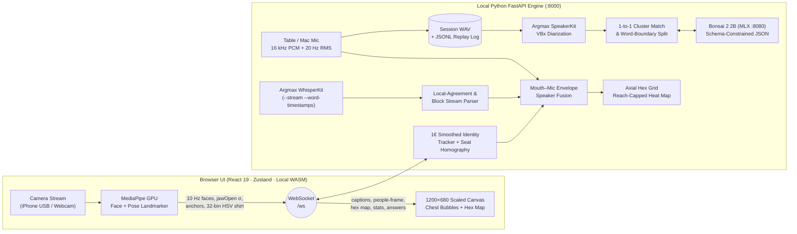

<div align="center">


# Roundtable

### **Your conversation, mapped — live, offline, for everyone.**

An on-device spatial captioning and meeting-mapping system built for Deaf and hard-of-hearing participants — running **100% locally on an 8 GB Apple Silicon laptop** with zero cloud calls.

[](#privacy--zero-network-guarantee)
[](#on-device-model-stack)
[-5B8DEF?style=flat-square)](#on-device-model-stack)
[](#how-it-works)
[-2DD4A7?style=flat-square)](#verification--test-suite)

</div>

---

## Why Roundtable Exists

Standard live-captioning tools dump a single wall of unattributed text at the bottom of a screen. For a Deaf or hard-of-hearing student in a seminar—or a teammate in a fast-moving roundtable—three critical pieces of information disappear immediately:

1. **Who is speaking right now** (by the time you scan the room to check mouths, the next person is already talking).
2. **When your name is called** (the single moment Deaf participants report missing most in group discussions).
3. **Where the conversation is happening** and which questions are still hanging unanswered.

Cloud meeting bots solve none of this in person—and require streaming private room audio and video to external servers.

**Roundtable** turns a laptop, a camera, and a table mic into a spatial, real-time conversation mapper. It pins color- and shape-coded speech bubbles directly onto each speaker's chest, flashes a full-stage alert the instant an enrolled name or alias is spoken, maps conversational energy across the physical tabletop, and refines the entire transcript by voice when the meeting ends—**entirely offline, inside ~6 GB of unified memory**.

And like closed captions and curb cuts, what makes a room accessible for a Deaf participant makes it dramatically better for everyone else: instant speaker-attributed notes, unanswered-question tracking, talk-time balance, and cited Q&A over what was just decided.

---

## What Happens on Screen

### 1. Setup & Seat Enrollment
- **Tabletop Homography:** Optional 4-corner tabletop calibration projects 2D camera coordinates onto real-world meters (`1.8 m × 0.9 m`), falling back automatically to horizontal camera-space seating on a laptop webcam.
- **Gated Voice & Face Enrollment:** Each participant presses **Begin recording** and reads two short sentences (~5 s) starting with their name. MediaPipe binds their face position while Argmax captures their voice print, warning immediately if two voices land in the same SpeakerKit cluster.
- **Live Self-Identification:** Even without formal calibration, saying *"Hi, I'm Yoav"* or *"My name is Cello"* in live mode locks both your face track and your voice interval on the fly.

### 2. Live View (The Hero Screen)
- **Speaker-Pinned Chest Bubbles:** Captions render directly on each speaker's torso (automatically shifting above the head or beside the face with 0.5 s hysteresis if a torso is occluded, never covering a face).
- **Redundant Visual Identity:** Every speaker has both a distinct **high-contrast color** and a **geometric glyph** (`circle`, `square`, `diamond`, `triangle`) so attribution never relies on color perception alone.
- **Name-Call Alert:** Word-boundary, case-insensitive matching against enrolled names and aliases triggers a stage-wide border pulse, highlights the bubble, and marks the moment in caption history.
- **Pointy-Top Hex Room Map:** A live 2D tabletop map deposits voiced acoustic energy (`σ = 0.35 m` Gaussian) at each speaker's projected seat, using a **sqrt talk-share reach cap** so a quiet end-seat speaker never visually dominates a louder middle-seat speaker.
- **Live Transcript, Talk-Time Rings & Open Questions:** Real-time speech balance, deterministic question/reply tracking (flagging unanswered questions as overdue after 60 s), scrollable caption history (`H`), large-caption mode (`L`), and in-place typed Q&A (`⌘K`) without leaving the live view.

### 3. After Stop — Voice Refine & Cited Review
- **Full-Context SpeakerKit Diarization:** Runs `argmax-cli diarize` over the full session WAV, matching acoustic clusters 1-to-1 against enrollment intervals and high-confidence visual turns, splitting mid-turn speaker handoffs at word boundaries (*"Corrected N of M turns"*).
- **Local Bonsai 2 2B Synthesis:** Tags questions, decisions, and action items; distills discussion topics and an executive summary; and answers natural-language questions with clickable turn citations (`turn_0004`, `turn_0012`) that scroll and highlight the exact source lines.

---

## Architecture & Real-Time Pipeline



---

## Key Engineering Highlights

| Challenge on an 8 GB Laptop | How Roundtable Solves It |
| --- | --- |
| **Nodding, chewing & syllable dips fool raw jaw tracking** | `SpeakerFusion` computes a **0.65 s trailing mic RMS envelope** matched to MediaPipe's **0.60 s `jawOpen` standard-deviation window**, subtracting each person's silent-room jaw baseline so silent chewing and uncorrelated nodding score zero while natural inter-syllable consonant dips stay continuously attributed. |
| **Streaming Whisper redraws & mid-sentence revisions** | `StreamingTranscriptParser` reads unbuffered raw bytes (`NSUnbufferedIO=YES`), strips ANSI/control tokens, deduplicates flushed vs. newly confirmed segments even when Whisper revises words mid-clause, and biases decoding toward enrolled names via `--prompt`. |
| **Live diarization instability on truncated audio** | PyAnnote's 10 s sliding segmentation window is noisy in the final ~4 s of an open WAV. Roundtable lets camera + mic fusion own the instantaneous `<1 s` live edge while full-context SpeakerKit settles low-confidence or covered-mouth turns once they are `≥4.2 s` behind the live frontier—and auto-reconciles inverted seats if voice and mouth repeatedly cross-match. |
| **End-seat bias on spatial heat maps** | Without normalization, a quiet speaker on an open table end claims more hexes than a loud speaker squeezed in the middle. Each speaker's Gaussian reach is capped at `max(0.35 m, 0.70 m × √(talk_i / talk_max))`, verified by automated fairness tests (`45 / 31 / 25%` split). |
| **Small-model JSON reliability** | `BonsaiWorker` runs a priority queue (`ask > name > tag > layout`) with thinking disabled, stripping `<think>` blocks and markdown fences, extracting balanced JSON objects while respecting escaped quotes, validating against strict schemas, and retrying once with the validation error. |
| **Hardware-free cross-platform development** | `fake_session.py` pushes synthetic 3-speaker multi-turn scenarios (occlusion, seat swaps, temporary absence, unanswered overdue questions, name alerts) through the **exact** production tracker, fusion, and hex-heat code—so every UI screen is testable in deterministic replay mode without a camera or mic. |

---

## On-Device Model Stack

Nothing is fetched from a CDN or cloud API at runtime—including fonts (`InterVariable` bundled locally) and vision weights (`public/vision/`):

- **Live Speech-to-Text:** **Argmax WhisperKit** (`argmax-cli` / `whisperkit-cli transcribe --stream --word-timestamps`) running natively on Apple Silicon.
- **Voice Diarization & Refine:** **Argmax SpeakerKit** (`diarize --num-speakers N`) running on Apple Neural Engine (~1.2 s for a 2-minute meeting).
- **Local Reasoning, Summaries & Cited Q&A:** **Bonsai 2 2B** (`models/bonsai2-2b-mlx` via `mlx_vlm.server` on `127.0.0.1:8080`).
- **Face Blendshapes & Body Anchors:** **MediaPipe Face Landmarker + Pose Landmarker Lite** running in-browser via local WebAssembly + WebGL GPU delegate.

**Memory budget:** The full live stack (macOS + Chrome WebGL + WhisperKit + SpeakerKit + Bonsai 2 2B MLX) runs comfortably at **~5.9–6.4 GB** on an 8 GB M2 MacBook Air, monitored live in the UI's **On-Device Status** card.

---

## Quickstart

### Prerequisites
- **Node.js 20+** and **Python 3.11+**
- **macOS on Apple Silicon** for live hardware mode (`brew install whisperkit-cli` + local Bonsai 2 2B MLX weights).
- *Any OS (macOS / Windows / Linux)* for deterministic simulation & replay mode—no GPU, mic, or model weights required.

### Install
```bash
npm install
python3 -m pip install -r requirements.txt
```

### Option A — Full Live Stack on Apple Silicon (One Command)
Builds the production UI, launches **Bonsai 2 2B** on `:8080` (or reuses it if already warm), starts the live FastAPI + Argmax WhisperKit/SpeakerKit server on `:8000`, and serves everything from a single origin:

```bash
# Download local models once (while online before going offline):
npm run setup:models

# Build UI + start Bonsai 2 2B + start live backend on http://localhost:8000
npm run live
```

Open **`http://localhost:8000`** in **Google Chrome** (recommended for Continuity Camera / WebRTC permissions).

> **Clean shutdown:** Stop with `Ctrl+C` or `pkill -TERM -f backend.app.server` so Argmax cleanly releases the microphone.

### Option B — Deterministic Simulation / Replay Mode (Zero Hardware Needed)
Runs the full UI and Python tracker/fusion/heat/refine pipeline against a generated 91-second, 3-speaker multi-edge-case session with mock Bonsai:

```bash
npm start
```

Open **`http://localhost:8000`** and press **Start replay** (or `R`).

For hot-reload UI development across two terminals:
```bash
npm run backend    # FastAPI sim server on :8000
npm run dev        # Vite dev server on :5173 (proxies /ws and API to :8000)
```

---

## Keyboard Shortcuts

| Shortcut | Action |
| --- | --- |
| **`⌘K`** / **`Ctrl+K`** | Open typed meeting Q&A — shows an inline **Answer Card** with cited turns right on **Live**, or focuses the question box in **Review** |
| **`L`** | Toggle **Large-Caption Mode** (persisted per browser) |
| **`H`** | Toggle scrollable **Caption History** drawer with name-mention badges |
| **`R`** | **Demo safety net / Replay:** switches instantly to a prerecorded, already-refined morning session in live mode (clearly badged as a recording), or restarts the simulation in sim mode |

---

## Privacy & Zero-Network Guarantee

- **Air-gap ready:** Turn off Wi-Fi before the conversation starts. Continuity Camera works over USB, MediaPipe WASM + `.task` models load from `public/vision/`, Inter loads from `src/assets/`, and WhisperKit, SpeakerKit, and Bonsai 2 2B execute strictly on `127.0.0.1`.
- **Cache-safe local serving:** Hashed static bundles are served locally while `/`, `/index.html`, and `/sw.js` enforce `Cache-Control: no-cache, no-store, must-revalidate` alongside an on-screen git build hash (`Build <sha>`) so stale service workers never mask updates.
- **Full local auditability:** Every session writes self-contained artifacts under `sessions/<name>/` (`audio.wav`, `events.jsonl`, `anchors.jsonl`, `live_transcript.jsonl`, `refined_transcript.jsonl`, `metadata.json`) that can be replayed frame-for-frame offline.

---

## Verification & Test Suite

Roundtable ships with **115 automated tests** (31 Vitest browser/geometry/vision/UI tests + 84 Pytest backend tests) covering homography math, 1€ smoothing, mouth–mic envelope fusion, spoken self-introductions, streaming Whisper reprints, hex reach-cap fairness, Bonsai JSON extraction, SpeakerKit 1-to-1 cluster assignment, and WebSocket contract parity:

```bash
npm test            # Runs Vitest + Pytest
npm run typecheck   # Strict TypeScript check
npm run vision:check # Verifies all local MediaPipe WASM & model files exist
```

---

## Project Layout

```text
Roundtable/
├── backend/
│   ├── contract.py              # Canonical Python mirror of the WebSocket/REST schema
│   ├── app/
│   │   ├── server.py            # FastAPI + WebSocket hub, Argmax lifecycle, rolling voice check
│   │   ├── session.py           # SessionEngine: enrollment seat lock, self-intro ID, turn routing
│   │   ├── fusion.py            # 0.65 s RMS envelope + jawOpen fusion & active-speaker hysteresis
│   │   ├── tracking.py          # 1€ filter face/pose tracker, away timer, position + HSV matching
│   │   ├── transcribe.py        # Raw-byte Argmax stream parser & local-agreement turn builder
│   │   ├── voiceid.py           # Balanced-clip & enrollment-collision SpeakerKit checks
│   │   ├── refine.py            # Full-WAV SpeakerKit 1-to-1 cluster assignment & mid-turn splits
│   │   ├── bonsai.py            # Priority queue worker, schema-constrained JSON ladder & mock
│   │   ├── calibration.py       # 4-point perspective homography, grid lines & center validation
│   │   ├── hexmap.py & heat.py  # Pointy-top axial hex math & reach-capped Gaussian energy
│   │   └── fake_session.py      # Deterministic 91 s synthetic session & replay generator
│   └── tests/                   # 84 Pytest unit & integration tests + real Argmax stream fixtures
├── src/
│   ├── contract.ts              # Canonical TypeScript mirror of backend/contract.py
│   ├── components/              # SetupScreen, EnrollScreen, LiveScreen, VideoStage, RoomMap, ReviewScreen
│   ├── vision/                  # Offline MediaPipe Face + Pose Landmarker pipeline & HSV histograms
│   ├── lib/                     # Homography, bubble collision layout, hex projection, name alerts
│   └── state/store.ts           # Zustand real-time client state & caption lifecycle
├── public/vision/               # Vendored MediaPipe WASM runtime + .task model weights
└── scripts/                     # One-command live launcher (live.py) & offline asset checks
```
